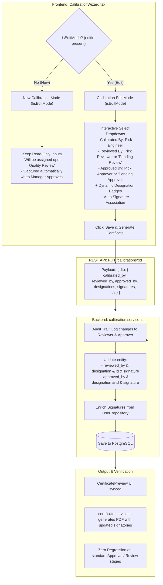

# Phase Plan: Enable Editing & Saving of Signatories ("Reviewed By" & "Approved By") in Calibration Edit Mode

**Phase Slug:** `03-edit-calibration-signatories-reviewed-approved-by`  
**Target Module:** Calibration Wizard (`/calibration/new?editId=...`), Certificate Preview, Backend Calibration Service (`update`), and Signatories Workflow.  
**Mode:** Tracer-First, Non-Breaking, 100% Safe Backward Compatibility  
**Status:** 📋 READY FOR EXECUTION  

---

## 1. Executive Summary & Problem Diagnosis

### The Problem
In the **Calibration Wizard** (`/calibration/new?editId={id}`), when a user with edit permissions edits an existing calibration record (such as the one shown in the production screenshot):
1. **Calibrated By** allows selecting an engineer from the company's team via a `<Select>` dropdown (if Admin).
2. **Reviewed By** is hardcoded as a disabled/read-only `<Input>` displaying `"Will be assigned upon Quality Review"`.
3. **Approved By** is hardcoded as a disabled/read-only `<Input>` displaying `"Captured automatically when Manager Approves"`.

If an organization needs to reassign or correct who reviewed or approved a calibration during edit (e.g. retroactive correction, signatory adjustments, or quality oversight), they are completely blocked because the inputs cannot be changed. Furthermore, in the backend `CalibrationService.update()`, `dto.approved_by_designation`, `reviewed_by_id`, and `approved_by_id` are not assigned to the entity, causing potential data loss even if sent.

### User Requirement
Enable the option to edit/change **Reviewed By** and **Approved By** while editing a calibrated item, and ensure the changes **must save** properly to the database and reflect on the generated certificate, **without breaking any existing functionality or approval workflow logic**.

---

## 2. Root Cause Analysis & Architectural Audit

### A. Frontend Limitation in `CalibrationWizard.tsx` (Lines 7261–7281)
In [CalibrationWizard.tsx](file:///e:/Gaugemaster/gaugemaster/frontend/src/pages/CalibrationWizard.tsx#L7261-L7281):
```tsx
{/* Reviewed By (Pending Manager Review) */}
<div className="space-y-2">
  <Label className="text-xs font-semibold">Reviewed By</Label>
  <Input
    value={reviewedBy || "Pending Review"}
    readOnly
    className="bg-muted/20 text-muted-foreground italic cursor-not-allowed text-xs h-9"
  />
  <span className="text-[10px] text-muted-foreground block">Will be assigned upon Quality Review</span>
</div>

{/* Approved By (Captured automatically on Approval) */}
<div className="space-y-2">
  <Label className="text-xs font-semibold">Approved By</Label>
  <Input
    value={approvedBy || "Pending Approval"}
    readOnly
    className="bg-muted/20 text-muted-foreground italic cursor-not-allowed text-xs h-9"
  />
  <span className="text-[10px] text-muted-foreground block">Captured automatically when Manager Approves</span>
</div>
```
- Both controls are unconditionally rendered as read-only inputs regardless of whether `isEditMode` is `true`.
- Designation badges are only rendered for "Calibrated By", not for "Reviewed By" or "Approved By".
- `reviewedById` and `approvedById` states are not tracked when loading the calibration record.

### B. Backend Omissions in `calibration.service.ts` (Lines 1830–1838)
In [calibration.service.ts](file:///e:/Gaugemaster/gaugemaster/backend/src/calibration/calibration.service.ts#L1830-L1838):
```ts
if (dto.calibrated_by !== undefined) existing.calibrated_by = dto.calibrated_by;
if (dto.calibrated_by_designation !== undefined) existing.calibrated_by_designation = dto.calibrated_by_designation;
if (dto.reviewed_by !== undefined) existing.reviewed_by = dto.reviewed_by;
if (dto.reviewed_by_designation !== undefined) existing.reviewed_by_designation = dto.reviewed_by_designation;
if (dto.approved_by !== undefined) existing.approved_by = dto.approved_by;
if (dto.calibrated_by_signature !== undefined) existing.calibrated_by_signature = dto.calibrated_by_signature;
if (dto.reviewed_by_signature !== undefined) existing.reviewed_by_signature = dto.reviewed_by_signature;
if (dto.approved_by_signature !== undefined) existing.approved_by_signature = dto.approved_by_signature;
```
- `dto.approved_by_designation` was **completely omitted** (it updates `existing.approved_by`, but skips `existing.approved_by_designation`).
- `dto.reviewed_by_id` and `dto.approved_by_id` are not copied over to `existing`.
- In `keysToTrack` for the audit log (line 1710), `reviewed_by_designation` and `approved_by_designation` are not included in audit change tracking.

### C. DTO Schema in `create-calibration.dto.ts`
[create-calibration.dto.ts](file:///e:/Gaugemaster/gaugemaster/backend/src/calibration/dto/create-calibration.dto.ts) lacks explicit optional declarations for `calibrated_by_id`, `reviewed_by_id`, and `approved_by_id`, though the underlying TypeORM entity [calibration.entity.ts](file:///e:/Gaugemaster/gaugemaster/backend/src/calibration/calibration.entity.ts#L199-L210) already has `reviewed_by_id` and `approved_by_id` database columns.

---

## 3. Solution Architecture & Non-Breaking Guarantee



---

## 4. Scope & Requirements Matrix

| ID | Requirement | Target File(s) | Verification & Safety Gate |
|---|---|---|---|
| **REQ-1** | **Reviewed By Select Dropdown in Edit Mode** | [CalibrationWizard.tsx](file:///e:/Gaugemaster/gaugemaster/frontend/src/pages/CalibrationWizard.tsx) | When `isEditMode` is active, render `<Select>` with `systemUsers` + `"Pending Review"`. Updates `reviewedBy`, `reviewedByDesignation`, `reviewedBySignature`, and `reviewedById`. |
| **REQ-2** | **Approved By Select Dropdown in Edit Mode** | [CalibrationWizard.tsx](file:///e:/Gaugemaster/gaugemaster/frontend/src/pages/CalibrationWizard.tsx) | When `isEditMode` is active, render `<Select>` with `systemUsers` + `"Pending Approval"`. Updates `approvedBy`, `approvedByDesignation`, `approvedBySignature`, and `approvedById`. |
| **REQ-3** | **Designation Badges for All Signatories** | [CalibrationWizard.tsx](file:///e:/Gaugemaster/gaugemaster/frontend/src/pages/CalibrationWizard.tsx) | Display clean, responsive designation chips below Reviewed By and Approved By matching Calibrated By. |
| **REQ-4** | **Preserve 100% Logic for New Calibrations** | [CalibrationWizard.tsx](file:///e:/Gaugemaster/gaugemaster/frontend/src/pages/CalibrationWizard.tsx) | When `!isEditMode`, keep existing read-only inputs and helper text without changing default behavior. |
| **REQ-5** | **Save Signatory IDs and Signatures in Edit Payload** | [CalibrationWizard.tsx](file:///e:/Gaugemaster/gaugemaster/frontend/src/pages/CalibrationWizard.tsx) | `executeSaveAndContinue` includes `reviewed_by_id`, `approved_by_id`, `calibrated_by_id`, and designations. |
| **REQ-6** | **Backend Entity & DTO Synchronization** | [create-calibration.dto.ts](file:///e:/Gaugemaster/gaugemaster/backend/src/calibration/dto/create-calibration.dto.ts), [calibration.service.ts](file:///e:/Gaugemaster/gaugemaster/backend/src/calibration/calibration.service.ts) | Add missing `approved_by_designation`, `reviewed_by_id`, `approved_by_id` to entity update and audit logging. |
| **REQ-7** | **Signature Resolution & PDF Regeneration** | [calibration.service.ts](file:///e:/Gaugemaster/gaugemaster/backend/src/calibration/calibration.service.ts), [certificate.service.ts](file:///e:/Gaugemaster/gaugemaster/backend/src/calibration/certificate.service.ts) | Ensure `enrichSignatures` and PDF generator render the updated reviewer/approver signature and name. |
| **REQ-8** | **Audit Trail Logging Integrity** | [calibration.service.ts](file:///e:/Gaugemaster/gaugemaster/backend/src/calibration/calibration.service.ts) | All signatory changes (names and designations) are properly logged to `audit_logs` for compliance. |

---

## 5. Detailed Step-by-Step Implementation Plan

### Step 1: Backend DTO & Service Update
1. **In `backend/src/calibration/dto/create-calibration.dto.ts`**:
   - Add optional `@IsString() calibrated_by_id?: string;`
   - Add optional `@IsString() reviewed_by_id?: string;`
   - Add optional `@IsString() approved_by_id?: string;`

2. **In `backend/src/calibration/calibration.service.ts`**:
   - In `update()` method:
     * Add `'reviewed_by_designation'` and `'approved_by_designation'` to `keysToTrack`.
     * Update `existing.approved_by_designation = dto.approved_by_designation;` (fix the omission).
     * Update `existing.reviewed_by_id = (dto as any).reviewed_by_id;` and `existing.approved_by_id = (dto as any).approved_by_id;`.
     * Ensure `enrichSignatures(existing)` resolves signatures for both `reviewed_by` and `approved_by` whenever a valid name/ID is present.

### Step 2: Frontend State & Loading Updates (`CalibrationWizard.tsx`)
1. **Add Signatory ID States**:
   ```tsx
   const [reviewedById, setReviewedById] = useState("");
   const [approvedById, setApprovedById] = useState("");
   const [calibratedById, setCalibratedById] = useState("");
   ```
2. **In the Edit Loader `useEffect`**:
   Load existing IDs:
   ```tsx
   setCalibratedById((cal as any).calibrated_by_id || (cal as any).created_by?.id || "");
   setReviewedById((cal as any).reviewed_by_id || "");
   setApprovedById((cal as any).approved_by_id || "");
   ```
3. **In `executeSaveAndContinue`**:
   Pass all signatory fields:
   ```ts
   calibrated_by: calibratedBy,
   calibrated_by_designation: calibratedByDesignation,
   calibrated_by_signature: calibratedBySignature,
   calibrated_by_id: calibratedById || undefined,
   reviewed_by: reviewedBy,
   reviewed_by_designation: reviewedByDesignation,
   reviewed_by_signature: reviewedBySignature,
   reviewed_by_id: reviewedById || undefined,
   approved_by: approvedBy,
   approved_by_designation: approvedByDesignation,
   approved_by_signature: approvedBySignature,
   approved_by_id: approvedById || undefined,
   ```

### Step 3: Frontend UI Rendering in Step 3 Signatories (`CalibrationWizard.tsx`)
Replace the static `readOnly` inputs for **Reviewed By** and **Approved By** with conditional controls:

1. **Reviewed By**:
   - If `isEditMode`:
     ```tsx
     <Select
       value={
         systemUsers.find((u) => u.name === reviewedBy || u.id === reviewedBy || u.id === reviewedById)?.id ||
         (reviewedBy === "Pending Review" || !reviewedBy ? "__PENDING_REVIEW__" : reviewedBy)
       }
       onValueChange={(val) => {
         if (val === "__PENDING_REVIEW__") {
           setReviewedBy("Pending Review");
           setReviewedByDesignation("");
           setReviewedBySignature("");
           setReviewedById("");
           return;
         }
         const selected = systemUsers.find((u) => u.id === val || u.name === val);
         if (selected) {
           setReviewedBy(selected.name);
           setReviewedByDesignation(selected.designation || getRoleName(selected.role) || "Quality Reviewer");
           setReviewedById(selected.id);
           if (selected.signature) setReviewedBySignature(selected.signature);
         }
       }}
     >
       <SelectTrigger className="h-9 text-xs font-semibold bg-background">
         <SelectValue placeholder="Select Reviewer" />
       </SelectTrigger>
       <SelectContent>
         <SelectItem value="__PENDING_REVIEW__" className="italic text-muted-foreground">
           Pending Review (Unassigned)
         </SelectItem>
         {systemUsers.map((u) => (
           <SelectItem key={u.id} value={u.id}>
             {u.name} ({getRoleName(u.designation) || getRoleName(u.role) || "Reviewer"})
           </SelectItem>
         ))}
       </SelectContent>
     </Select>
     ```
     With Designation badge below it:
     ```tsx
     <div className="flex items-center gap-1.5 px-3 py-1.5 bg-emerald-50 dark:bg-emerald-950/50 rounded-md border border-emerald-200 dark:border-emerald-800 text-xs shadow-sm">
       <span className="font-semibold text-slate-500 dark:text-slate-400">Designation:</span>
       <span className="font-bold text-emerald-950 dark:text-emerald-100 uppercase tracking-wide text-[11px]">
         {getRoleName(reviewedByDesignation) || "QUALITY REVIEWER"}
       </span>
     </div>
     ```
   - If `!isEditMode`: Keep exact existing `<Input readOnly ... />` and helper text.

2. **Approved By**:
   - If `isEditMode`:
     ```tsx
     <Select
       value={
         systemUsers.find((u) => u.name === approvedBy || u.id === approvedBy || u.id === approvedById)?.id ||
         (approvedBy === "Pending Approval" || !approvedBy ? "__PENDING_APPROVAL__" : approvedBy)
       }
       onValueChange={(val) => {
         if (val === "__PENDING_APPROVAL__") {
           setApprovedBy("Pending Approval");
           setApprovedByDesignation("");
           setApprovedBySignature("");
           setApprovedById("");
           return;
         }
         const selected = systemUsers.find((u) => u.id === val || u.name === val);
         if (selected) {
           setApprovedBy(selected.name);
           setApprovedByDesignation(selected.designation || getRoleName(selected.role) || "Quality Manager / Approver");
           setApprovedById(selected.id);
           if (selected.signature) setApprovedBySignature(selected.signature);
         }
       }}
     >
       <SelectTrigger className="h-9 text-xs font-semibold bg-background">
         <SelectValue placeholder="Select Approver" />
       </SelectTrigger>
       <SelectContent>
         <SelectItem value="__PENDING_APPROVAL__" className="italic text-muted-foreground">
           Pending Approval (Unassigned)
         </SelectItem>
         {systemUsers.map((u) => (
           <SelectItem key={u.id} value={u.id}>
             {u.name} ({getRoleName(u.designation) || getRoleName(u.role) || "Approver"})
           </SelectItem>
         ))}
       </SelectContent>
     </Select>
     ```
     With Designation badge below it:
     ```tsx
     <div className="flex items-center gap-1.5 px-3 py-1.5 bg-purple-50 dark:bg-purple-950/50 rounded-md border border-purple-200 dark:border-purple-800 text-xs shadow-sm">
       <span className="font-semibold text-slate-500 dark:text-slate-400">Designation:</span>
       <span className="font-bold text-purple-950 dark:text-purple-100 uppercase tracking-wide text-[11px]">
         {getRoleName(approvedByDesignation) || "QUALITY MANAGER / APPROVER"}
       </span>
     </div>
     ```
   - If `!isEditMode`: Keep exact existing `<Input readOnly ... />` and helper text.

### Step 4: Certificate Preview & PDF Sync Verification
1. Ensure the `<CertificatePreview>` mock objects in `CalibrationWizard.tsx` (lines 7360–7368 and lines 7785–7795) receive the updated `reviewed_by_id`, `approved_by_id`, and designations.
2. In `backend/src/calibration/certificate.service.ts`, ensure that if `calibration.approved_by` is set (or calibration is Approved), it prints the designated Approver name, designation, and signature.

---

## 6. Safety Guardrails & Risk Analysis

| Potential Risk | Severity | Probability | Mitigation Strategy |
|---|---|---|---|
| Breaking New Calibration creation | High | Zero | Guarded strictly behind `isEditMode`. For new calibrations (`!isEditMode`), the UI renders the identical read-only inputs with identical default messages. |
| Approval Workflow status corruption | High | Zero | Edit mode does NOT modify `approval_status`. The separate approval endpoints (`/approve`, `/review`, `/reject`) remain completely untouched. |
| Missing signatures when changing user | Medium | Zero | When a signatory is selected from `systemUsers`, their stored signature in base64 is automatically assigned to `reviewedBySignature` / `approvedBySignature`, and backend `enrichSignatures` provides a fallback. |
| Unassigned / Pending state regression | Medium | Zero | Select dropdowns include `"__PENDING_REVIEW__"` and `"__PENDING_APPROVAL__"` allowing the user to preserve or revert to unassigned status cleanly. |
| Database schema breaking | High | Zero | No schema changes required: all database columns (`reviewed_by`, `reviewed_by_id`, `reviewed_by_designation`, `reviewed_by_signature`, `approved_by`, `approved_by_id`, `approved_by_designation`, `approved_by_signature`) already exist in PostgreSQL via migration `1779350000000`. |

---

## 7. Verification & Testing Protocol

1. **Compilation & Static Analysis**:
   - Backend: Run `npm run build` or `npx tsc --noEmit` in `backend/` to verify zero TypeScript errors.
   - Frontend: Run `npm run build` or `npx tsc --noEmit` in `frontend/` to verify zero type mismatches.
2. **Automated Unit / Integration Tests**:
   - Run backend calibration service tests: `npm test -- calibration.service.spec.ts`.
3. **End-to-End Browser Testing**:
   - Navigate to `/calibration/new?editId=0734daf3-7a7b-4a1a-95d6-9815059e4832` (or any existing calibration).
   - In Step 3 (Signatories), verify:
     * "Reviewed By" is an interactive Select dropdown displaying the currently assigned reviewer.
     * "Approved By" is an interactive Select dropdown.
     * Both have dynamic Designation badges beneath them.
   - Change "Reviewed By" to another user (e.g. "Iviewsense" or another team member).
   - Change "Approved By" to a quality manager.
   - Click "Save & Generate Certificate".
   - Verify success toast notification.
   - Check the Certificate Preview (Step 4) and generated PDF: verify both signatories and signatures reflect the newly saved users.
   - Inspect Audit Log: verify the change event is logged with old and new values.
   - Navigate to `/calibration/new` (New Calibration mode): verify Reviewed By and Approved By remain read-only inputs with "Will be assigned upon Quality Review" and "Captured automatically when Manager Approves".
